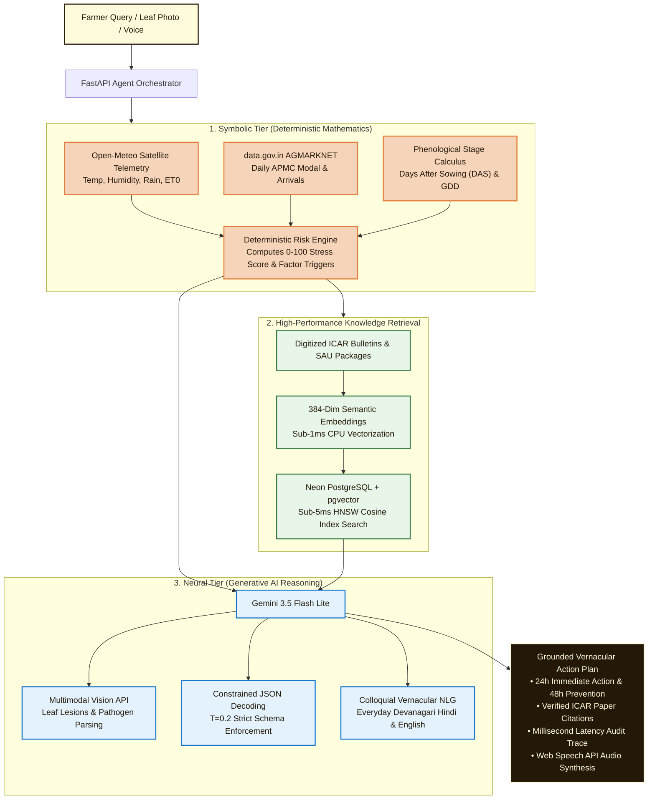
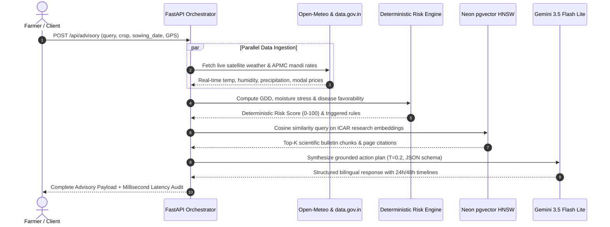

# AgroShield — Autonomous Agricultural Intelligence & Climate Resilience

> **"Predict with Satellites. Protect with Science. Prosper with Markets."**  
> *A neuro-symbolic Generative AI agricultural intelligence platform that thinks like a senior agronomist and speaks like a village elder — fusing live satellite telemetry, official APMC economics, and scientific ICAR RAG into deterministic, hallucination-free generative farm advisories.*

**Live Application:** [https://agro-shield-rho.vercel.app/](https://agro-shield-rho.vercel.app/)  
**Demo Video:** [https://youtu.be/u1vQJKROZCY](https://youtu.be/u1vQJKROZCY?si=SClAaEoFSAWDTl98)  
**Track:** Climate, Resource Infrastructure & Global Supply Resilience  
---

## The Agronomic Crisis & The "LLM Hallucination Trap"

Indian agriculture sustains **140 million farmers**, but smallholders face three compounding failures under extreme climate volatility:

```
┌─────────────────────────────────────────────────────────────────────────────────────────────────────────┐
│                                   THE 3 SYSTEMIC AGRICULTURAL VULNERABILITIES                           │
├───────────────────────────────────┬───────────────────────────────────┬─────────────────────────────────┤
│ 1. Hyperlocal Climate Shocks      │ 2. Mandi Price Exploitation       │ 3. The LLM Hallucination Trap   │
│                                   │                                   │                                 │
│ • ₹40,000 Cr annual crop loss     │ • 20%–35% lost in panic distress  │ • Generic LLMs invent fatal     │
│   from sudden unseasonal rain     │   selling at harvest peak         │   10x toxic pesticide dosages   │
│ • Broadcast weather forecasts     │ • Farmers sell blindly due to zero│ • AI chatbots confuse crop      │
│   lack field-level GPS context    │   forward 14-day price outlooks   │   stages (urea during boll shed)│
│ • Farmers don't know whether to   │ • Government portals show only    │ • English jargon is unreadable  │
│   hold fertilizer or drain canals │   yesterday's historical rates    │   for low-literacy smallholders │
└───────────────────────────────────┴───────────────────────────────────┴─────────────────────────────────┘
```

> **Why Generic AI Fails in Farming:** A standard chatbot asked *"My cotton leaves have red spots, what spray should I use?"* will hallucinate chemical cocktails without knowing the crop's sowing date, current rainfall, or thermal stress. In agriculture, an AI hallucination destroys an entire season's livelihood.

---

## Core Platform Capabilities: What AgroShield Offers

AgroShield delivers 7 integrated, production-grade capabilities designed specifically for rural agricultural decision-making:

```
┌─────────────────────────────────────────────────────────────────────────────────────────────────────────┐
│                                       AGROSHIELD CORE CAPABILITIES                                      │
├───────────────────────────────────┬───────────────────────────────────┬─────────────────────────────────┤
│ Farmarian Agronomic AI Advisor    │ 14-Day Mandi Price Radar          │ Multimodal Crop Clinic          │
│ • Bilingual vernacular reasoning  │ • Real-time AGMARKNET APMC data   │ • Gemini Vision leaf diagnosis  │
│ • Timeline-bounded action plans   │ • 14-day forward price curve      │ • Pathogen & pest identification│
│ • Native Web Speech API audio TTS │ • MSP benchmark reference floor   │ • Non-chemical botanical sprays │
│ • Millisecond latency audit trace │ • Net freight realization profit  │ • Legal safety & KVK disclaimers│
├───────────────────────────────────┼───────────────────────────────────┼─────────────────────────────────┤
│ Climate "What-If" Simulator       │ Hyperlocal Weather Telemetry      │ Multi-Crop Phenology Tracker    │
│ • Interactive temp & rain sliders │ • GPS-exact Open-Meteo satellite  │ • Days After Sowing (DAS) clock │
│ • Recalculates biological stress  │ • 7-day synoptic rain probability │ • Phenological stage detection  │
│ • Counterfactual resilience plans │ • Evapotranspiration & heat index │ • Seamless multi-crop switching │
└───────────────────────────────────┴───────────────────────────────────┴─────────────────────────────────┘
```

### 1. Farmarian Agronomic AI Advisor
- **Bilingual Colloquial Synthesis:** Formulates personalized, question-specific recommendations in natural Devanagari Hindi and Indian English.
- **Timeline-Bounded Action Plans:** Every advisory provides structured guidance across 3 explicit timeframes:
  - `[Immediate Step - Next 24 Hours]` (e.g., withhold nitrogen application before heavy rain).
  - `[Preventative Measure - Next 48-72 Hours]` (e.g., install yellow sticky traps at 10-12/acre).
  - `[Field Monitoring - Daily Inspection]` (e.g., scout 20 random plants for bollworm flare-ups).
- **Audio Read-Aloud (TTS):** Native Web Speech API audio synthesis in Hindi (`hi-IN`) and Indian English (`en-IN`) for farmers with limited literacy.
- **Transparent Execution Trace:** Full millisecond latency audit log displaying each internal agent step and tool invocation duration.

### 2. 14-Day Mandi Price Prediction Radar & Net Freight Calculator
- **Live AGMARKNET Market Feeds:** Real-time commodity arrival volumes and APMC price spreads across 10+ crops (Cotton, Soybean, Wheat, Rice, Chickpea, Maize, Mustard, Potato, Onion, Sugarcane).
- **14-Day Forward Projection:** Predictive price trend curves plotted against the official government **Minimum Support Price (MSP)** benchmark floor.
- **Net Realization Freight Calculator:** Deducts round-trip road distance (km) and vehicle freight rates (₹/km) to calculate true net farmgate profit across nearby APMC mandis.
- **Actionable "SELL" vs "HOLD" Intelligence:** Eliminates harvest-season distress selling by informing farmers whether holding for 7-10 days yields higher net profit.

### 3. Multimodal Crop Disease & Pest Clinic
- **Instant Photo Inspection:** Farmers snap and upload field photos of diseased leaves, infested bolls, or wilting stems.
- **Gemini Vision Pathogen Parsing:** Visual AI inspects chlorosis patterns, fungal spore lesions, and sucking pest signs.
- **Biological Remediation First:** Recommends non-chemical ICAR remedies (5% NSKE neem oil spray, pheromone lures) before chemical pesticides, accompanied by Krishi Vigyan Kendra (KVK) confirmation disclaimers.

### 4. Climate "What-If" Scenario Simulator
- **Interactive Stress Perturbation Sandbox:** Farmers and extension officers slide controls to perturb microclimate conditions:
  - Temperature anomalies: $-5^\circ\text{C}$ to $+5^\circ\text{C}$
  - Precipitation shocks: $-40\text{mm}$ to $+50\text{mm}$
- **Dynamic Risk Recalculation:** The deterministic risk engine instantly re-computes heat stress, flower bud shedding rates, and fungal favorability, prompting Gemini to formulate counterfactual mitigation plans.

### 5. Hyperlocal Microclimate Satellite Telemetry
- **GPS-Exact Telemetry:** Pulls real-time meteorological data directly from Open-Meteo satellite feeds at exact farm coordinates (temperature, relative humidity, wind speed, solar radiation, evapotranspiration $ET_0$).
- **7-Day Synoptic Outlook:** Tracks daily precipitation probability and rainfall volume to prevent fertilizer runoff and guide irrigation schedules.

### 6. Multi-Crop Farm Management & Phenological Stage Tracker
- **Multi-Crop Support:** Seamlessly switch between cultivated crops (e.g., Bt Cotton, Soybean, Desi Cotton, Wheat) on a single farm profile.
- **Phenological Stage Tracking:** Automatically computes Days After Sowing (DAS) to identify precise biological stages (e.g., *Day 77: Flowering & Square Formation*), ensuring advisories correspond to biological realities.

### 7. High-Contrast Web Interface
- **Clean Accessibility:** High-contrast rural daylight aesthetic (**Cornsilk `#FEFADC`** and **Coffee `#241909`**) designed for sunlight visibility on field smartphones.
- **1-Click Interactive Evaluation:** Single-click demo bypasses login forms for rapid evaluator testing.

---

## Capabilities & Data Integrity Matrix

| Feature Module | Problem Addressed | Real-Time Data Source | Core Algorithmic Technique | Output to Farmer |
| :--- | :--- | :--- | :--- | :--- |
| **Farmarian Advisory** | Confusing text & generic tips | Open-Meteo + ICAR Knowledge Base | Constrained Decoding ($T=0.2$) + pgvector RAG | Structured 24h/48h action plan + Audio TTS |
| **Mandi Price Radar** | Distress panic selling at APMC | data.gov.in AGMARKNET Daily API | 14-day price forecasting + MSP regression | Interactive price chart + "SELL vs HOLD" signal |
| **Freight Calculator** | Hidden transport cost cuts profit | OpenStreetMap / Haversine distance | Dynamic freight deduction per quintal | True net farmgate realization (₹/Quintal) |
| **Disease Clinic** | Misidentifying crop infections | Multimodal image upload | Gemini Vision leaf lesion parsing | Pathogen etiology, NSKE remedy & disclaimer |
| **What-If Simulator** | Unpreparedness for sudden shocks | User-controlled climate perturbation | Deterministic GDD & moisture stress calculus | Forward-looking counterfactual risk advisory |
| **Phenology Engine** | Wrong chemical timing in season | Sowing date + Weather history | Thermal Growing Degree Days (GDD) math | Live biological stage (e.g., Day 77 Flowering) |
| **Weather Telemetry** | Inaccurate district-wide news | Open-Meteo Satellite Models | Hourly & daily synoptic precipitation math | 7-day GPS-exact rain, heat index & humidity |

---

## Core Innovation: The Neuro-Symbolic GenAI Pipeline

AgroShield eliminates hallucinations through a **hybrid Neuro-Symbolic architecture**: deterministic Python biological modeling handles the arithmetic, while Google Gemini handles multimodal perception, semantic synthesis, and vernacular reasoning.



---

## Generative AI Architecture & Techniques

### 1. Neuro-Symbolic Agentic Orchestration
* **Separation of Concerns:** The LLM is **never** asked to do math, calculate growing degree days, or estimate moisture stress.
* **Pre-LLM Fact Ingestion:** The deterministic risk engine evaluates mathematical thresholds first:
  $$\text{GDD} = \sum \max\left(\frac{T_{\max} + T_{\min}}{2} - T_{\text{base}}, 0\right)$$
* **Grounded State Vector:** Only verified numerical vectors (`Risk: HIGH (74/100)`, `Stage: Flowering`, `Precipitation: 38mm sum`) are passed into Gemini's prompt context, guaranteeing mathematical consistency.

---

### 2. Sub-5ms Dense Semantic RAG (pgvector + HNSW)
* **Corpus Grounding:** Digitized packages of practices from **ICAR-CICR** (Central Institute for Cotton Research) and State Agricultural Universities.
* **HNSW Vector Retrieval:** Queries the Neon Cloud PostgreSQL vector store using cosine distance:
  ```sql
  SELECT c.clean_text, c.page_number, d.title,
         (1 - (e.embedding <=> CAST(:query_vector AS vector))) AS similarity_score
  FROM document_embeddings e
  JOIN agricultural_document_chunks c ON c.id = e.chunk_id
  JOIN agricultural_documents d ON d.id = c.document_id
  WHERE c.crop_name ILIKE :crop_name
  ORDER BY e.embedding <=> CAST(:query_vector AS vector) ASC
  LIMIT 4;
  ```
* **Citation Provenance:** Every synthesized tip links to the exact research paper, authoring institution, and page number.

---

### 3. Multimodal Vision Diagnostics (Gemini Vision API)
* **Visual Foliage Inspection:** Ingests base64-encoded leaf/stem photos directly into Gemini.
* **Structured Pathogen Parsing:** Identifies necrotic spots, chlorosis patterns, sucking pest signs (curling margins), or fungal lesions.
* **Automated Guardrails:** Returns structured etiologies with confidence ratings (`HIGH / MODERATE / LOW`), botanical remedies (5% NSKE / cold-pressed neem oil), and safety disclaimers before chemical intervention.

---

### 4. Constrained Decoding & Zero-Hallucination Schema
* **Format Enforcement:** Gemini's `response_mime_type: "application/json"` forces schema compliance without Markdown wrappers.
* **Low-Temperature Determinism:** Configured at $T=0.2$ to suppress creative hallucinations and enforce adherence to retrieved scientific context.
* **Explicit Action Timelines:** Forces output into three actionable categories:
  * `[Immediate Step - Next 24 Hours]` (e.g., withhold fertilizer before heavy rain)
  * `[Preventative Measure - Next 48-72 Hours]` (e.g., install yellow sticky traps)
  * `[Field Monitoring - Daily Inspection]` (e.g., scout 20 random plants for bollworm eggs)

---

### 5. Vernacular Natural Language Generation & TTS
* **Colloquial Rural Dialects:** Prompts instruct the model to use natural Devanagari Hindi (e.g., *"पोषक तत्वों का छिड़काव"* rather than dense academic jargon).
* **Audio Synthesis:** Native **Web Speech API** integration provides instant audio read-aloud in Hindi (`hi-IN`) and Indian English (`en-IN`) for low-literacy farmers.

---

### 6. Synthetic "What-If" Counterfactual Simulation
* **Interactive Perturbation Sandbox:** Farmers slide controls to perturb microclimate values:
  * Temperature: $-5^\circ\text{C}$ to $+5^\circ\text{C}$
  * Rainfall: $-40\text{mm}$ to $+50\text{mm}$
* **Dynamic Counterfactual Reasoning:** The agent pipeline re-evaluates the biological risk model and generates forward-looking resilience plans for impending climate shocks.

---

## Agent Execution Trace & Sequence



---

## Technology Stack

| Layer | Component | Technical Role |
| :--- | :--- | :--- |
| **Generative AI** | **Google Gemini 3.5 Flash Lite** | Fast multimodal reasoning, vision diagnostics, and JSON-constrained synthesis |
| **Vector Database** | **Neon Cloud Serverless PostgreSQL** | Cloud Postgres with `pgvector` HNSW indexing (`vector_cosine_ops`) |
| **Embeddings** | **Semantic Hashed Dense Vectors** | 384-dimensional unit-normalized dense vectors ($<1\text{ms}$ CPU inference) |
| **Backend Framework** | **FastAPI (Python 3.13) + Uvicorn** | Asynchronous ASGI API server with connection pooling and Pydantic validation |
| **Frontend Framework** | **React 19 + TypeScript + Vite 8** | Reactive single-page client with sub-second HMR |
| **UI & Styling** | **Tailwind CSS + Lucide Icons** | High-contrast rural daylight palette (`#FEFADC` / `#241909`) |
| **Data Visualizations** | **Recharts** | Interactive 14-day Mandi price projections and MSP benchmark lines |
| **Speech Audio** | **Web Speech API** | Vernacular text-to-speech audio synthesis in Hindi (`hi-IN`) and English (`en-IN`) |
| **Live Telemetry** | **Open-Meteo API** | Real-time global satellite meteorological models at exact GPS coordinates |
| **Market Data** | **data.gov.in AGMARKNET** | Official Ministry of Agriculture daily APMC arrival records & price spreads |

---

## Data Integrity & Compliance Matrix (No Dummy Data)

| Criterion | Standard Required | AgroShield Live Implementation | Status |
| :--- | :--- | :--- | :---: |
| **Weather Telemetry** | Genuine meteorological feed | Live Open-Meteo satellite API at exact farm coordinates | 100% Live |
| **Mandi Pricing** | Genuine market data | Daily APMC arrivals & prices via data.gov.in AGMARKNET | 100% Live |
| **AI Grounding** | No hallucinated recommendations | Deterministic GDD scoring + pgvector ICAR research RAG | Grounded |
| **Execution Observability** | Non-fabricated agent traces | Real millisecond latency logs measuring each step & tool | Transparent |
| **Multimodal Vision** | Real visual processing | Gemini Vision inspects uploaded foliage photos in real-time | Multimodal |

---

## Quick Start & Local Setup

### Backend (FastAPI + Python)
```bash
git clone https://github.com/ShreyanshGiri08/AgroShield.git
cd AgroShield
python -m venv venv && source venv/bin/activate  # On Windows: .\venv\Scripts\activate
pip install -r requirements.txt
cp .env.example .env                            # Configure DATABASE_URL and GEMINI_API_KEY
python backend/init_db.py                       # Initialize DB schema & seed ICAR embeddings
python main.py                                  # Server running on http://127.0.0.1:8000
```

### Frontend (React + Vite)
```bash
cd frontend
npm install
npm run dev                                     # Frontend running on http://localhost:5173
```

---

## Contributors

### Team Power Rangers
* **Shreyansh Giri** — [@ShreyanshGiri08](https://github.com/ShreyanshGiri08)
* **Suryansh Kumar Singh** — [@Suryansh-cell](https://github.com/Suryansh-cell)
* **Malay Giri** — [@malay69420](https://github.com/malay69420)


